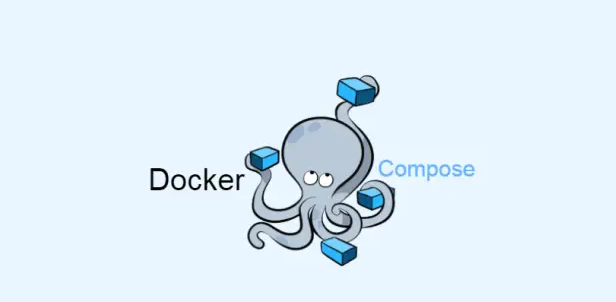

# 🐳 Docker Compose Exercises

<p align="center">
  
</p>


<p align="center">
  <strong>Build images. Connect services. Keep data. Run applications.</strong><br>
  Hands-on container exercises completed by <a href="https://github.com/AStoyan0ff">Andrey Stoyanov</a>.
</p>

## 🚀 About this repository

This repository contains my solutions to the SoftUni Docker Compose exercise sheet: custom Dockerfiles, container networking, Docker Hub publishing, persistent storage, and applications composed of multiple services.

The application source code comes from the course resources. My work focuses on container configuration, building and running the applications, verifying their behavior, and documenting the results. Screenshots from the local runs are available in [9.Pictures](9.Pictures/).

## 🧭 Exercises at a glance

The order below includes the introductory MariaDB exercise. Folder numbers follow the supplied resource archives; TaskBoard shares one folder across three exercises.

| # | Exercise | Stack | Local access | Status |
|---|---|---|---|---|
| 1 | MariaDB server and client | MariaDB · Docker network | Interactive SQL client | ✅ Completed |
| 2 | TaskBoard image build and publishing | ASP.NET Core 6 · Docker Hub | Image build | ✅ Completed |
| 3 | Tracker App | Vue.js · NGINX | `http://localhost:8080` | ✅ Completed |
| 4 | TaskBoard container networking | ASP.NET Core 6 · SQL Server | `http://localhost:8081` | ✅ Completed |
| 5 | TODO App | React · Node.js · MongoDB | `http://localhost:3002` | ✅ Completed |
| 6 | TaskBoard with Compose | ASP.NET Core 6 · SQL Server | `http://localhost:8081` | ✅ Completed |
| 7 | Blue vs Green | Python · Redis · .NET · PostgreSQL · Node.js | Vote `:5000` · Results `:5001` | ✅ Completed |
| 8 | Reseller App | Spring Boot · Java 11 · MySQL | `http://localhost:8000` | ✅ Completed |
| 9 | Simple Page | Django · Python · Gunicorn | `http://localhost:8000` | ✅ Completed |

## 🧰 What I practiced

- Writing Dockerfiles and using multiple build stages.
- Building, tagging, and publishing images to Docker Hub.
- Connecting containers through named Docker networks and service names.
- Mapping host ports to container ports.
- Using bind mounts for application files and named volumes for database storage.
- Configuring applications through environment variables.
- Using healthchecks with `depends_on: condition: service_healthy`.
- Reading logs and checking configuration with `docker compose config --quiet`.
- Testing application flows through the browser and SQL client.

## 📂 Repository layout

| Folder | Contents |
|---|---|
| `1-3-5 TaskBoard/` | TaskBoard source, multi-stage Dockerfile, and Compose configuration |
| `2. Tracker-App/` | Vue frontend built and served through NGINX |
| `4. TODO-App/` | React frontend and Node.js backend Dockerfiles |
| `6. Blue-vs-Green/` | Voting application with five services and two networks |
| `7. Reseller-Page/` | Spring Boot source, Dockerfile, and MySQL Compose configuration |
| `8. Simple-Page/SimplePageApp/` | Django source, Dockerfile, and Compose configuration |
| `9.Pictures/` | Execution screenshots and README banner |

## ⚙️ Before running

Use Docker Desktop with Linux containers and Docker Compose. The examples below use **PowerShell**, with commands run from the repository root unless a different directory is shown.

Run applications one at a time where ports overlap: Reseller and Simple Page both use host port **8000**. The manual TaskBoard container and the Compose version both use **8081**.

Credentials included in these exercises are local demonstration values. Several application and runtime versions are retained from the course resources; these configurations are intended for local learning.

## 🐬 1 · MariaDB server and client

This introductory task uses CLI commands rather than a source-code folder. On a fresh setup:

```powershell
docker network create mariadb_network
docker pull mariadb:latest
docker run -d --name mariadb_server --network mariadb_network -e MARIADB_ROOT_PASSWORD=MariaDB123 mariadb:latest
```

Wait for the server logs to report that it is ready, then open the client:

```powershell
docker logs mariadb_server
docker run -it --name mariadb_client --network mariadb_network mariadb:latest mariadb -h mariadb_server -u root -p
```

Enter the demonstration password when prompted, then execute:

```sql
SHOW DATABASES;
```

The client reaches the server by container name through the shared network. The original exercise was run without an explicitly named database volume.

## 📋 2, 4 & 6 · TaskBoard

The Dockerfile builds the application using the .NET 6 SDK, then copies the published output into an ASP.NET runtime image.

```powershell
cd "1-3-5 TaskBoard"
docker build -f TaskBoard.WebApp/Dockerfile -t astoyan0ff/taskboard:1.1 .
docker compose config --quiet
docker compose up -d
```

Open **http://localhost:8081** and use the demonstration account **`guest` / `guest`**.

The Compose configuration creates a shared network and a named SQL Server volume. A SQL healthcheck runs `SELECT 1`; TaskBoard waits for SQL Server to become healthy.

**Verified:** sign-in, creating a task, displaying it on the board, and retaining the task after stopping and starting the services.

The earlier image **`astoyan0ff/taskboard:1.0`** was published to Docker Hub during the image-building exercise. Version **`1.1`** includes the connection string using `sqlserver` as the hostname; build it locally before running the Compose configuration.

## ✅ 3 · Tracker App

This Dockerfile builds the Vue application in a Node stage and serves the generated files using NGINX.

```powershell
cd "2. Tracker-App"
docker build -t astoyan0ff/tracker_app:1.0 .
docker run -d --name tracker_app -p 8080:80 astoyan0ff/tracker_app:1.0
```

Open **http://localhost:8080**.

**Verified:** the interface loads and a new task can be added. The image was also published to Docker Hub.

## 📝 5 · TODO App

This exercise was completed using individual Docker commands: React frontend, Node.js backend, and MongoDB on `todo_network`.

Build the two application images:

```powershell
cd "4. TODO-App"
docker build -t astoyan0ff/todo_backend:1.0 ./backend
docker build -t astoyan0ff/todo_frondend:1.0 ./frontend
```

The frontend image tag intentionally matches the spelling used during the exercise: **`todo_frondend`**.

On a fresh setup, create the network and start MongoDB:

```powershell
docker network create todo_network
docker run -d --name mongo --network todo_network -v todo_mongo_data:/data/db mongo:latest
```

When MongoDB is ready, start the backend:

```powershell
docker run -d --name todo_backend --network todo_network -p 3001:3000 -e NODE_ENV=development astoyan0ff/todo_backend:1.0
docker logs todo_backend
```

After the backend reports `MongoDB is connected`, start the frontend:

```powershell
docker run -d --name todo_frondend --network todo_network -p 3002:3000 -e NODE_ENV=development astoyan0ff/todo_frondend:1.0
```

Open **http://localhost:3002**. The frontend proxy points to **`http://todo_backend:3000/`**, using the container port inside the network. MongoDB uses the named volume `todo_mongo_data`.

**Verified:** creating todos and loading them again after refreshing the page.

## 🔵🟢 7 · Blue vs Green

| Service | Responsibility | Networks |
|---|---|---|
| `vote` | Python voting interface | `frontend`, `backend` |
| `redis` | Queues votes | `backend` |
| `worker` | .NET process transferring votes to PostgreSQL | `backend` |
| `db` | PostgreSQL vote storage | `backend` |
| `result` | Node.js interface displaying results | `frontend`, `backend` |

```powershell
cd "6. Blue-vs-Green"
docker compose config --quiet
docker compose build
docker compose up -d
```

- Vote: **http://localhost:5000**
- Results: **http://localhost:5001**

The Python vote image uses Gunicorn. The worker uses a multi-stage .NET Core 3.1 build. The Compose file mounts the vote and result source directories and stores PostgreSQL data in `db_data`, mounted at `/var/lib/postgresql` for the newer PostgreSQL image layout.

**Verified:** voting, displaying the result, and switching from Green to Blue in the same browser while keeping a total of one vote.

## ☕ 8 · Reseller App

The application uses Spring Boot 2.6.7 and Java 11. Maven runs inside Docker, so a local Maven installation is not required.

First, create the executable JAR from the source directory:

```powershell
cd "7. Reseller-Page"
docker run --name reseller_build -w /app -v "${PWD}:/app" maven:3.9-eclipse-temurin-11 mvn clean package -DskipTests
```

The output is **`target/ResellerApp-0.0.1-SNAPSHOT.jar`**. The Dockerfile copies this JAR into an Eclipse Temurin Java 11 JRE image.

Tests were skipped for this packaging step after the supplied `contextLoads` test failed to load the Spring context. This build is not a passing automated-test result; application behavior was checked separately with MySQL.

```powershell
docker build -t astoyan0ff/reseller:1.0 .
docker compose config --quiet
docker compose up -d
```

Open **http://localhost:8000**.

The Compose configuration supplies the datasource URL, credentials, and `SPRING_JPA_HIBERNATE_DDL_AUTO=update`, overriding the original `create-drop` setting. Reseller waits for the MySQL healthcheck. Database files use `reseller_mysql_data`.

**Verified:** registration, sign-in, adding an offer, and displaying it after a page refresh. The application image was published to Docker Hub.

## 🐍 9 · Simple Page

This application uses Django 4.2.4, Python 3.11, and Gunicorn.

```powershell
cd "8. Simple-Page/SimplePageApp"
docker compose config --quiet
docker compose up --build -d
```

Open **http://localhost:8000**.

The newsletter template includes `` and a `` inside its POST form. The missing CSRF token in the supplied form was fixed during verification.

**Verified:** page loading and form submission without a CSRF error. The supplied view renders the page; it does not save subscriptions or send emails.

The supplied settings use `DEBUG = True`. Setting `DEBUG` in the container environment alone does not change this Python setting unless the settings code reads that variable.

## 🛠️ Useful commands

Run Compose commands from the directory containing the application's Compose file.

| Goal | Command |
|---|---|
| Validate configuration | `docker compose config --quiet` |
| Build application images | `docker compose build` |
| Start services in the background | `docker compose up -d` |
| Build and start services | `docker compose up --build -d` |
| Inspect service status | `docker compose ps -a` |
| Read recent logs | `docker compose logs --tail 20` |
| Stop services and keep containers | `docker compose stop` |
| List running containers | `docker ps` |
| Include stopped containers | `docker ps -a` |
| View disk usage | `docker system df` |

Stopping containers preserves them and their data. Images are stored templates, not running processes. The standalone `docker run --name ...` examples assume those container names are unused; use `docker start` for existing stopped containers instead of creating duplicates.

---

<p align="center">
  <strong>Built, connected, and tested — one container at a time.</strong><br>
  🐳 <a href="https://github.com/AStoyan0ff">AStoyan0ff</a> · <a href="https://hub.docker.com/u/astoyan0ff">Docker Hub</a> ☕
</p>
